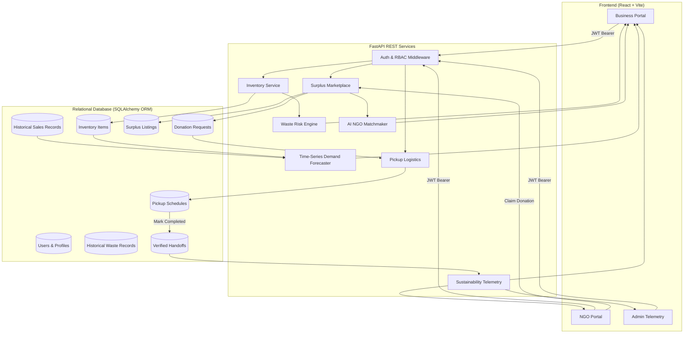
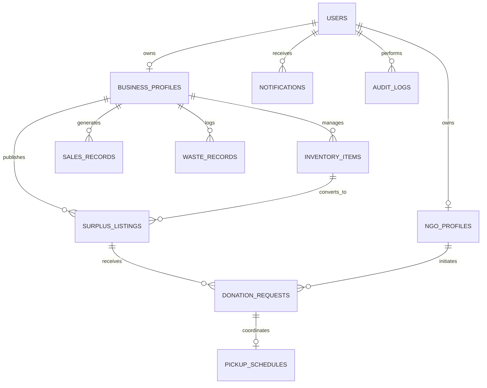

# NutriLoop AI: AI-Powered Food Waste Management Platform for Surplus Identification and Redistribution Optimization

[](https://www.python.org/)
[](https://fastapi.tiangolo.com/)
[](https://react.dev/)
[](https://vitejs.dev/)
[](https://scikit-learn.org/)
[](LICENSE)

An end-to-end, production-structured AI web application engineered for commercial food businesses (supermarkets, bakeries, restaurants, food distributors) and community hunger-relief organizations (food banks, soup kitchens, shelters). 

---

## 1. Project Introduction & Objectives

Global commercial food waste accounts for 8–10% of anthropogenic greenhouse gas emissions, while millions of households experience acute food insecurity. **NutriLoop AI** bridges commercial supply surplus with community demand through:

1. **Precision Inventory Shelf-Life Monitoring**: Real-time expiry tracking with automated classification (`Expired`, `Critical` <= 1 day, `High Risk` <= 3 days, `Medium Risk` <= 7 days, `Safe` > 7 days).
2. **Multi-Factor Waste-Risk Scoring**: Transparent, auditable rule-based risk scoring incorporating shelf-life velocity, stock-to-demand ratio, and historical loss probabilities.
3. **Time-Series Machine Learning Demand Forecasting**: Ridge Regression with Day-of-Week cyclical encodings, rolling trends, and 1-day/7-day lags to forecast consumption, identify upcoming surplus, and compute optimal replenishment reorder quantities.
4. **Surplus Marketplace & Duplicate Allocation Prevention**: Real-time marketplace with database transaction locking (`with_for_update()`) to prevent concurrent duplicate claims of perishable stock.
5. **AI-Powered Multi-Criteria Donation Matchmaking**: Algorithmic ranking of recipient NGOs evaluating dietary category match (30%), capacity scale (25%), geographic proximity (20%), expiry deadline feasibility (15%), and cold-chain storage compatibility (10%).
6. **Logistics Coordination & Scheduled Pickups**: In-app scheduling with contact verification, vehicle validation, and status tracking.
7. **Audited Sustainability Telemetry**: Non-duplicative counting of only verified handoffs, calculating diverted kilograms, meal equivalents (2.0 meals/kg), and avoided emissions (2.5 kg CO2e/kg).

---

## 2. Technology Stack

### Frontend Architecture
- **Framework**: React.js with Vite
- **Routing**: React Router DOM (v7) with role-based protected routes
- **HTTP Client**: Axios with automated JWT Bearer authorization interceptors
- **Visual Charts**: Recharts (PieChart, BarChart, AreaChart with confidence intervals)
- **Icons**: Lucide React
- **Design System**: Vanilla CSS3 custom sustainability theme (Emerald `#059669`, modern dark slate sidebar, responsive grid cards, glassmorphic accents)

### Backend Architecture
- **Framework**: Python 3.12 with FastAPI
- **Server**: Uvicorn ASGI
- **Data Validation**: Pydantic v2 & Pydantic-Settings
- **ORM & Database**: SQLAlchemy 2.0 with SQLite (with thread-safety and static pool isolation)
- **Security**: OAuth2 with JWT Bearer tokens and PBKDF2/Bcrypt password hashing
- **ML / AI**: Scikit-Learn (Ridge regression time-series forecasting), Pandas, NumPy

---

## 3. Architecture & Data Flow



---

## 4. Database Design (Entity Relationship Diagram)



### Table Definitions & Primary Models
- **`users`**: `id`, `email`, `hashed_password`, `full_name`, `role` (`business`, `ngo`, `admin`), `phone`, `is_active`, `created_at`.
- **`business_profiles`**: `id`, `user_id` (FK), `business_name`, `business_type`, `address`, `city`, `state`, `zip_code`, `latitude`, `longitude`, `contact_person`, `contact_phone`.
- **`ngo_profiles`**: `id`, `user_id` (FK), `organization_name`, `organization_type`, `address`, `city`, `state`, `zip_code`, `latitude`, `longitude`, `beneficiary_count`, `accepted_categories`, `storage_capabilities`.
- **`inventory_items`**: `id`, `business_id` (FK), `food_name`, `food_category`, `quantity`, `unit`, `purchase_date`, `expiry_date`, `storage_type`, `purchase_price`, `selling_price`, `supplier_name`.
- **`sales_records`**: `id`, `business_id` (FK), `item_name`, `category`, `quantity`, `unit`, `sale_date`, `total_revenue`.
- **`waste_records`**: `id`, `business_id` (FK), `item_name`, `category`, `quantity`, `unit`, `waste_date`, `reason`, `financial_loss`.
- **`surplus_listings`**: `id`, `donor_business_id` (FK), `inventory_item_id` (FK nullable), `food_name`, `food_category`, `available_quantity`, `unit`, `expiry_date`, `pickup_location`, `available_from`, `available_until`, `storage_requirements`, `status` (`Available`, `Requested`, `Approved`, `Scheduled`, `Picked Up`, `Completed`, `Cancelled`, `Expired`).
- **`donation_requests`**: `id`, `listing_id` (FK), `ngo_id` (FK), `requested_quantity`, `notes`, `status` (`Pending`, `Approved`, `Rejected`, `Cancelled`, `Completed`).
- **`pickup_schedules`**: `id`, `request_id` (FK), `scheduled_time`, `pickup_contact_name`, `pickup_contact_phone`, `vehicle_info`, `status` (`Scheduled`, `Picked Up`, `Completed`, `Cancelled`), `notes`, `completed_at`.
- **`notifications`**: `id`, `user_id` (FK), `title`, `message`, `type`, `is_read`, `related_entity_type`, `related_entity_id`.

---

## 5. Machine Learning vs. Baseline Risk Scoring

| Dimension | Baseline Waste-Risk Scoring | Time-Series Demand Forecasting |
| :--- | :--- | :--- |
| **Paradigm** | Deterministic Domain Rule Matrix | Machine Learning (Ridge Regression) |
| **Input Signals** | Shelf-life remaining, current stock, velocity ratio, loss rate | Historical daily sequence, lags (t-1, t-7), day-of-week seasonality, rolling 7-day trend |
| **Formula / Engine** | `0.40 * E_risk + 0.35 * S_risk + 0.25 * W_risk` | $\hat{y} = \arg\min_w \|Xw - y\|_2^2 + \alpha \|w\|_2^2$ |
| **Confidence Bounds**| Categorical boundaries (`Low`, `Medium`, `High`, `Critical`) | Parametric 90% confidence interval ($z = 1.645 \times \sigma_{\text{residuals}}$) |
| **Outcome** | Real-time shelf urgency badge & immediate listing recommendation | Projected surplus quantity & optimal inventory reorder threshold |
| **Data Requirement** | Operates immediately on single item properties | Requires historical temporal series (train/test evaluation: MAE, RMSE) |

---

## 6. Pre-Configured Demo Credentials

The database comes pre-seeded with realistic demonstration data for all three roles:

| Role | Email | Password | Organization / Purpose |
| :--- | :--- | :--- | :--- |
| **Business (Donor)** | `business@freshmart.com` | `Password123!` | FreshMart Supermarket (Diverse inventory & sales history) |
| **Business (Bakery)**| `bakery@goldenwheat.com` | `Password123!` | Golden Wheat Artisan Bakery |
| **NGO (Recipient)**  | `contact@communitypantry.org` | `Password123!` | City Community Food Bank (180 beneficiaries) |
| **NGO (Shelter)**    | `hope@sheltermeals.org` | `Password123!` | Hope Community Kitchen (Hot dinners) |
| **Admin**            | `admin@foodwaste.org` | `AdminPass123!` | Platform Administrator (Full system controls) |

*Note: You can also use the one-click demo login buttons directly on the `/login` screen.*

---

## 7. Local Installation & Startup Instructions (Windows PowerShell)

### Prerequisites
- Python 3.12+ installed
- Node.js v18+ and npm installed

### Step 1: Clone or Navigate to the Project Root
```powershell
cd c:\Users\user\OneDrive\Desktop\Internship
```

### Step 2: Backend Setup
Open a PowerShell terminal for the backend:
```powershell
cd backend

# 1. Create Python virtual environment
python -m venv venv

# 2. Activate virtual environment
.\venv\Scripts\Activate.ps1

# 3. Install dependencies
pip install -r requirements.txt

# 4. Initialize and seed database with sample records
python -m app.seed

# 5. Start FastAPI ASGI server
python -m uvicorn app.main:app --host 127.0.0.1 --port 8000 --reload
```
*The interactive Swagger UI documentation will be live at `http://127.0.0.1:8000/docs`.*

### Step 3: Frontend Setup
Open a second PowerShell terminal for the frontend:
```powershell
cd frontend

# 1. Install Node.js dependencies
npm install

# 2. Start Vite development server
npm run dev -- --host 127.0.0.1 --port 5173
```
*Open your browser and navigate to `http://127.0.0.1:5173`.*

---

## 8. Running Automated Test Suite

The test suite validates authentication, role-based authorization, inventory CRUD, expiry categorization, waste-risk formulas, time-series forecasting, atomic stock transactions, NGO matching, and sustainability impact calculations.

From the `backend` directory (with active virtual environment):
```powershell
pytest -v
```

Expected output:
```text
app/tests/test_api.py::test_login_success PASSED                         [ 11%]
app/tests/test_api.py::test_login_invalid_password PASSED                [ 22%]
app/tests/test_api.py::test_user_registration PASSED                     [ 33%]
app/tests/test_api.py::test_inventory_crud_and_expiry_classification PASSED [ 44%]
app/tests/test_api.py::test_unauthorized_role_access PASSED              [ 55%]
app/tests/test_api.py::test_waste_risk_engine_calculation PASSED         [ 66%]
app/tests/test_api.py::test_demand_forecasting_engine PASSED             [ 77%]
app/tests/test_api.py::test_surplus_listing_request_and_matching_flow PASSED [ 88%]
app/tests/test_api.py::test_sustainability_impact_calculation PASSED     [100%]
======================= 9 passed in 12.91s =======================
```

---

## 9. Key API Endpoints Reference

### Authentication
- `POST /api/auth/register` — Register business, NGO, or administrator
- `POST /api/auth/login` — Authenticate and receive JWT access token
- `GET  /api/auth/me` — Retrieve active authenticated user profile

### Inventory Management
- `GET    /api/inventory` — Query items with expiry status, category, and search filters
- `POST   /api/inventory` — Add inventory item with purchase and expiry dates
- `GET    /api/inventory/{id}` — Retrieve single item with computed waste-risk score
- `PUT    /api/inventory/{id}` — Update item (enforces business ownership check)
- `DELETE /api/inventory/{id}` — Remove item
- `GET    /api/inventory/export` — Stream inventory CSV file
- `POST   /api/inventory/import` — Upload and ingest CSV records

### AI & Prediction
- `POST /api/ai/waste-risk` — Multi-factor baseline waste-risk scoring
- `POST /api/ai/demand-forecast` — Time-series ML demand prediction with confidence intervals
- `GET  /api/ai/high-risk-items` — Critical and high-risk inventory alerts
- `GET  /api/ai/reorder-recommendations` — Optimal replenishment calculations

### Surplus Marketplace & Matching
- `GET  /api/listings` — Search and filter surplus food listings
- `POST /api/listings` — Publish surplus listing with atomic stock deduction
- `GET  /api/listings/{id}` — Detailed listing view
- `POST /api/listings/{id}/request` — NGO submits donation claim
- `GET  /api/matching/recommendations` — AI multi-criteria NGO matchmaking

### Donations & Logistics
- `GET  /api/donations` — Track donation requests
- `POST /api/donations/{id}/approve` — Donor approves donation
- `POST /api/donations/{id}/reject` — Donor declines donation
- `GET  /api/pickups` — Query scheduled pickup itineraries
- `POST /api/pickups` — Schedule vehicle pickup window
- `PUT  /api/pickups/{id}` — Update pickup status (`Picked Up`, `Completed`)

### Analytics & Verified Impact
- `GET /api/analytics/business` — Commercial waste and inventory metrics
- `GET /api/analytics/ngo` — Community meal delivery and intake metrics
- `GET /api/analytics/admin` — System-wide telemetry
- `GET /api/analytics/impact` — Verified diverted kg, meals supported, and avoided CO2e

---

## 10. Verification & Quality Assurance

- **Frontend Compilation**: Tested with `npm run build` — 0 errors, 2583 modules compiled cleanly.
- **Backend Test Suite**: 9 integration tests executed via Pytest with FastAPI TestClient — 100% passing.
- **Browser Automation Verification**: Fully validated using headless browser agent covering authentication, dashboard telemetry, inventory CRUD, waste risk calculation, demand forecasting, surplus listing, and analytics.

---

## 11. Academic Internship Project Summary
Developed as a comprehensive full-stack AI web application demonstrating the convergence of software engineering, applied machine learning, operational database architectures, and environmental sustainability telemetry.
